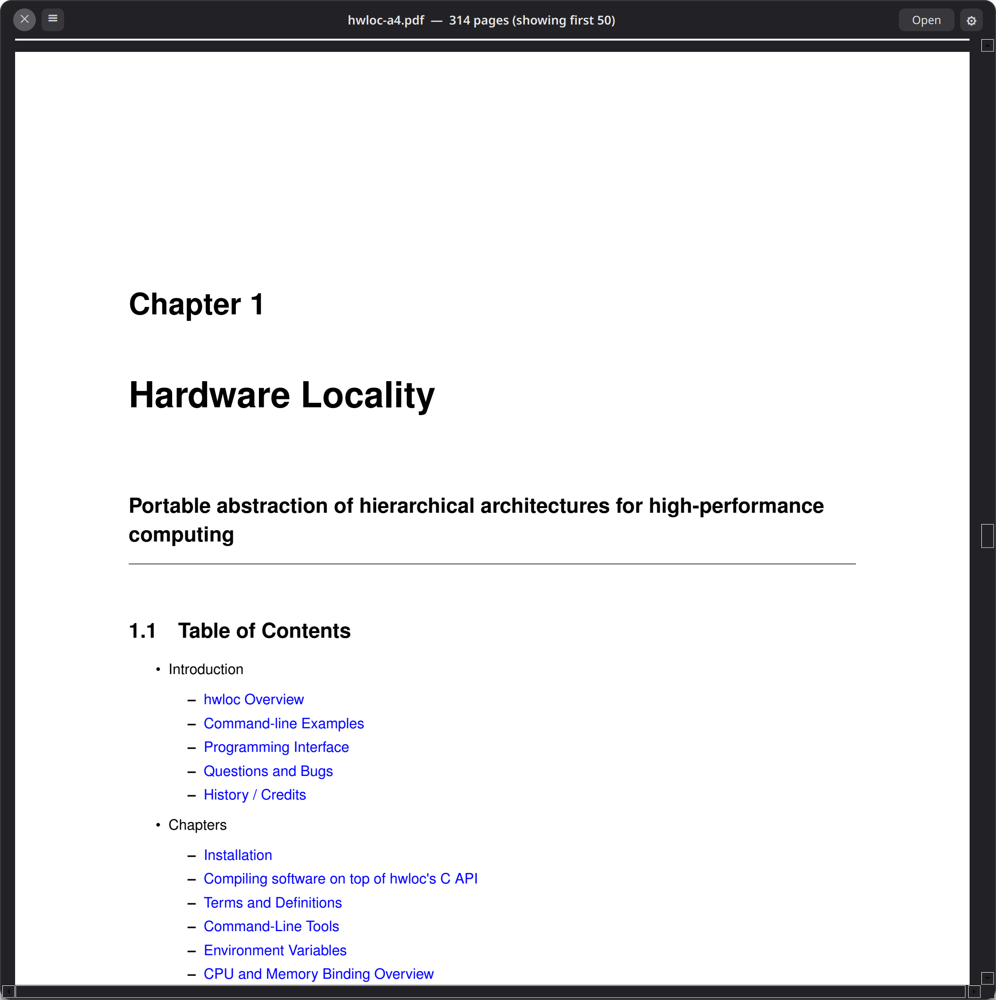
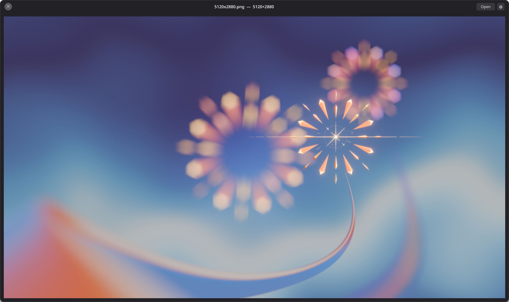
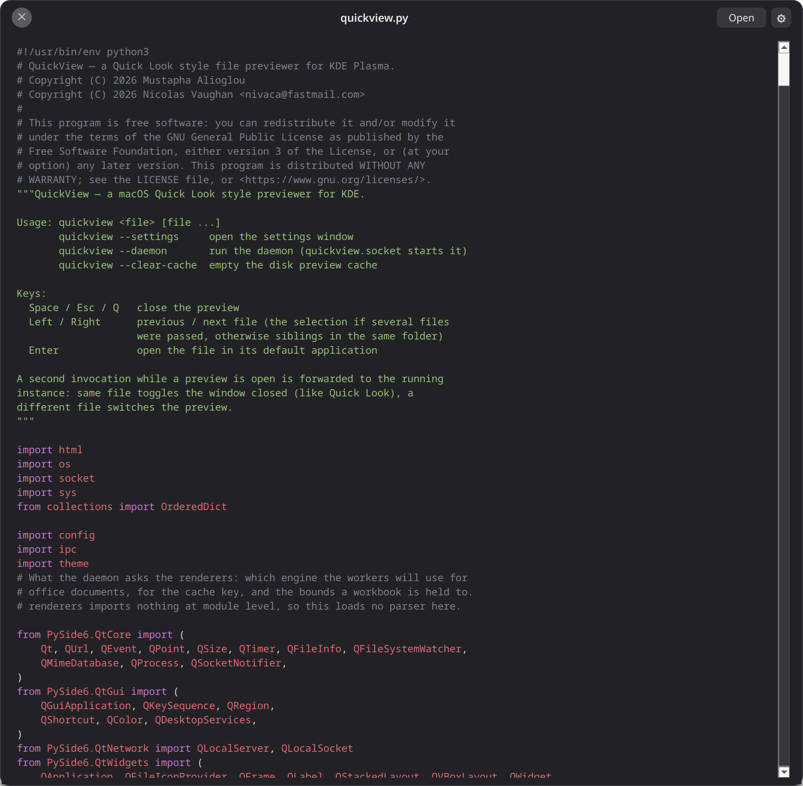
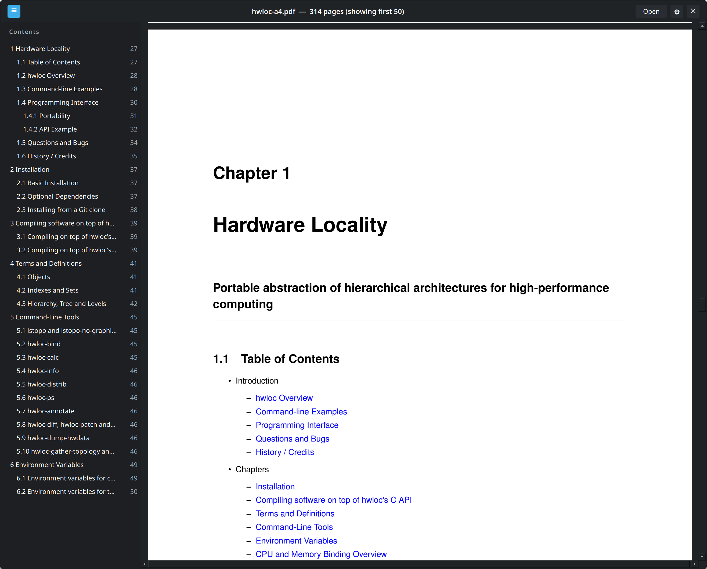
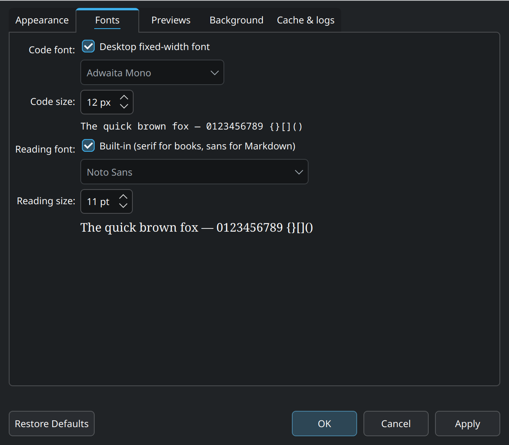

# QuickView for KDE Plasma 6

A macOS **Quick Look**–style file previewer for KDE Plasma. Select a file in
Dolphin, press **Space**, and a floating dark preview panel appears. Press
Space again (or Esc) to dismiss it.



<p align="center">
  
  
</p>

Multi-select works too: select **several files**, trigger QuickView, and
**← / →** pages through them — the title shows your position (e.g. `2/5`),
just like Quick Look on a multi-file selection.

> **About this fork.** This is [nivaca/QuickView][fork], a fork of
> [Mustapha Alioglou's QuickView][upstream] maintained by
> **Nicolas Vaughan** (<nivaca@fastmail.com>). It adds support for the
> **Flathub LibreOffice**, fixes a bug that could leave the panel hanging,
> splits the daemon into smaller modules and hardens the installer. See
> [Authors and contributions](#authors-and-contributions) for the details.

[fork]: https://github.com/nivaca/QuickView
[upstream]: https://github.com/MustaphaAlioglou/QuickView

## Features

- **Instant, and gone when idle.** A daemon keeps Qt loaded, so a preview
  appears in ~50 ms instead of the ~250–300 ms a cold start costs. Like
  macOS's Quick Look services it is started on demand — systemd holds its
  socket and starts it on the first Space press — and by default it exits
  after 10 minutes without a preview, giving its ~130 MB back. It can also
  stay resident, or not linger at all (see [The daemon](#the-daemon)). The
  launcher hands the path over in about 4 ms through a compiled client that
  loads no interpreter.
- **Every parser runs in a sandbox.** Images, PDFs, animations, audio,
  video, archives, office documents and the syntax highlighter all decode
  inside a bubblewrap jail with no network and no filesystem — the file
  arrives as a file descriptor. HTML is the exception only in that it uses
  Chromium's own renderer sandbox instead. The daemon holds the window, the
  socket and the cache, and no decoder at all.
- **← / →** walks the folder, or pages through a multi-file selection.
- **Find in PDFs and books.** **Ctrl+F** searches the text and highlights
  matches in place; **Enter** / **Shift+Enter** step through them. Phrases
  work, including across line breaks.
- **Contents sidebar.** The **☰** button top left lists a PDF's bookmarks, a
  book's chapters or a Markdown file's headings — nested and with page
  numbers; clicking one jumps to that heading, not merely to the page it is
  on. The button only appears when the
  document actually has a table of contents.
- **EPUB books are read, not listed.** The spine is laid out as pages with
  each chapter starting on its own page, and the book's own table of
  contents becomes the sidebar. The page colours are a setting —
  `book_theme = gruvbox-dark` (or `gruvbox-light`, `sepia`, `dark`, the
  default `paper`).
- **Markdown renders**, with a titlebar button flipping between the
  rendered pages and the highlighted source, and its headings in the
  contents sidebar. It uses the page palette too, so
  `book_theme = gruvbox-dark` themes both books and Markdown.
- **Syntax highlighting** for source files, lexed by Pygments inside the
  jail and themeable with any Pygments style. Extensionless scripts are
  recognised by their `#!` line.
- **Archives are listed, never extracted**, so an archive that expands to
  terabytes costs nothing to look at.
- **Office documents are laid out as pages**, like a PDF, rather than shown
  as a wall of text. With LibreOffice installed, slide decks get a page per
  slide, and old `.doc`, `.xls`, `.ppt` and `.rtf` files open too.
- **Spreadsheets open as a real grid**, one tab per sheet, with the column
  letters and row numbers the file actually uses, figures formatted the way
  the workbook formats them — decimals, thousands separators, currency,
  percentages, dates, negatives in brackets — and numeric columns aligned
  right. Old `.xls` workbooks get the same grid and tabs when LibreOffice
  is installed.
- **Media plays inline** with a seek bar, decoded and mixed in the jail.
- **HTML renders** with JavaScript off and the network blocked, and the
  titlebar flips to source view.
- **Two-tier preview cache**, in memory and on disk, so reopening a file is
  effectively instant. The files ← → would show next — images, PDFs and
  office documents — are warmed in the background while you look at the
  current one, so paging through a folder opens each in ~5 ms.
- **Office documents never wait for LibreOffice.** A docx or odt shows the
  built-in layout at once, and LibreOffice's pages replace it when they are
  ready, at the same place in the document.
- **Anything it cannot preview** still gets a card with its icon, type, size
  and modified date, so Space is never a dead key.
- **Configurable** through `~/.config/quickview/quickview.conf`, written with
  its defaults commented in on first run — including a **Breeze theme** that
  drops the Quick Look look and follows your Plasma colour scheme instead.
- **Self-contained.** `install.sh` builds a virtualenv and touches no system
  packages. **Enter** opens the file in its real application whenever the
  preview is not enough.

## What it previews

| Type                | How                                        |
|---------------------|--------------------------------------------|
| Images (PNG, JPG, WebP, SVG, …) | Scaled to fit, shows dimensions |
| Photoshop (PSD, PSB) | The flattened composite, scaled to fit — no layer is parsed |
| Krita / OpenRaster (KRA, ORA) | The flattened composite stored in the file |
| Animated GIFs       | Played inline                              |
| PDFs                | Scrollable multi-page view, Ctrl+F, bookmarks sidebar |
| Illustrator (AI)    | Rendered as the PDF it is, in the same page view |
| EPUB books          | Laid out as pages, Ctrl+F, chapter sidebar with page numbers |
| HTML                | Rendered page (JS off, network blocked) — titlebar button flips to source view |
| Video / audio       | Plays inline with a seek bar               |
| Markdown            | Rendered pages with a headings sidebar — titlebar button flips to the highlighted source |
| Text / code / CSV   | Monospace view with syntax highlighting (first 1 MiB) |
| Archives (zip, rar, 7z, tar…) | Contents listing with sizes — nothing is extracted |
| Spreadsheets (xlsx, xlsm, ods) | A table per sheet, with tabs along the bottom |
| Old Excel workbooks (xls) | The same table and tabs, converted by LibreOffice when it is installed; the metadata card otherwise |
| Office docs (docx, odt)  | Laid out as pages, like a PDF — exactly as LibreOffice lays them out when it is installed |
| Slide decks (pptx, ppsx, odp) | A page per slide with LibreOffice; without it, the thumbnail the deck embeds, with its text a button away |
| Legacy office (doc, ppt, rtf) | Laid out as pages by LibreOffice when it is installed; the metadata card otherwise |
| Folders             | Item count and contents listing            |
| Everything else     | Icon, type, size and modified date         |

## Keys (while the preview is open)

| Key             | Action                                   |
|-----------------|-------------------------------------------|
| Space / Esc / Q | Close the preview                         |
| ← / →           | Previous / next file — pages through the selection if several files were passed, otherwise folder siblings |
| Enter           | Open the file in its default application  |
| Ctrl+F          | Find text in a PDF, words or phrases — Enter and Shift+Enter step through matches, Esc closes |
| Ctrl+Q          | Quit the background daemon entirely       |

## Syntax highlighting

Source files are coloured by [Pygments][pyg], which runs **inside the jail**
with everything else — its lexers are regexes, and a file written to make one
backtrack should take down a throwaway worker, not the daemon that owns your
window. What comes back is the text plus a list of colour spans; the daemon
paints ranges and parses nothing.

The language is taken from the file's extension, and — when there is no
extension to go on — from its `#!` line, so a personal script kept as
`~/bin/deploy` rather than `deploy.sh` is still coloured:

```bash
#!/bin/bash                      → Bash
#!/usr/bin/env python3           → Python
#!/usr/bin/env -S deno run       → TypeScript
```

An extension Pygments recognises always wins; the shebang only fills the
gap where there is none. Pygments' own content guessing is deliberately not
used — it reads every lexer's `analyse_text()` over untrusted content, which
is both slow and wrong often enough to matter (it calls `#!/usr/bin/env node`
plain text).

Files over 256 KiB are shown unhighlighted (lexing 1 MiB takes ~1.5 s, which
is slower than the preview it decorates). Any Pygments style works:

```ini
# ~/.config/quickview/quickview.conf
[preview]
code_style = dracula   # gruvbox-dark, nord, monokai, native, …
```

See [Settings](#settings) below. Without Pygments installed the preview is
plain text — nothing breaks.

[pyg]: https://pygments.org/

## Panel theme

The panel is a Quick Look impression by default: a fixed dark window with a
round close button top left, drawn the same on every desktop and deliberately
ignoring your Plasma colour scheme. That is what the project set out to look
like and it stays the default.

If you would rather it matched the rest of your desktop:

```ini
# ~/.config/quickview/quickview.conf
[appearance]
panel_theme = breeze   # or the default, quicklook
```

Breeze takes every colour from the running `QPalette`, which under Plasma is
your own colour scheme — so it follows a light theme, a dark one and your
accent colour without being configured further, and it re-reads that palette
when you change schemes rather than waiting for a restart. It also squares
the corners off and moves the close button to the right, where a Plasma
window decoration puts it.



One thing it does not follow is `code_style`: the colours in a highlighted
source file come from Pygments, in the sandboxed worker, and the default
`one-dark` is built for a dark background. On a **light** Plasma scheme, set
a light style to go with it:

```ini
[preview]
code_style = solarized-light   # or one of Pygments' other light styles
```

Both themes fill the same set of tokens (`theme.py`), so there is one
stylesheet rather than two to keep in step, and a test checks that every
sheet can be filled by both.

## Preview cache

Image decodes are cached in two tiers (the `quicklookd` model):

- **Memory** — recently shown pixmaps stay in the daemon; re-showing or
  paging back with ← → skips decoding entirely.
- **Disk** — `~/.cache/quickview/previews/` (PNG entries, and the grid of
  an old `.xls` LibreOffice converted; capped at 256 MiB,
  pruned oldest-first). Keys embed the file's mtime + size, so a changed
  file re-renders automatically — no stale previews.

Clear it with `quickview --clear-cache`.

## Sandboxed rendering

**Every format QuickView decodes itself is parsed outside the daemon**,
inside a bubblewrap jail: still images, PDFs, animations, audio, video, and
the syntax highlighter. The daemon holds the window, the socket and the
cache — it does not hold a decoder. HTML is the one exception, and it is
covered under *What still runs in the daemon* below.

The jail has read-only `/usr`, this app folder and the font config, no
network (`--unshare-all`), no capabilities (`--cap-drop ALL`), no writes,
and — this is the part that matters — **no access to your files at all**.
The file arrives as a file descriptor passed over the worker socket, so
there is nothing to bind-mount and nothing for a compromised parser to go
looking for. A malformed file can only take down its own throwaway worker.

**It is also faster than parsing in-process was.** Entering the jail costs
about 3 ms; what used to cost ~150 ms per preview was importing Qt in a
fresh helper. So workers are booted *before* they are needed and parked on
a socket, and each one still handles exactly one file and then exits — the
same per-file isolation as a throwaway helper, with the startup paid by a
spare instead of by you. Measured on a 1-page PDF: 583 ms before, ~120 ms
now; a cached preview is ~2 ms.

- **Images** — decoded to a PNG that the daemon caches and displays.
- **Photoshop files** — Qt has no PSD handler, so this one format QuickView
  parses itself, in the jail with everything else and using nothing but the
  standard library. It reads the flattened composite Photoshop already stores
  alongside the layers and never touches a layer, so the expensive half of the
  format is the half a preview skips. The compressed image data carries a table
  of every scanline's length, which means rows can be *seeked past* rather than
  decoded: a 6000x4000 document shown in a 1600 px box decodes about a third of
  its rows and a third of each one: 95 ms against 281 ms for the same decode
  undecimated, and unlike the full decode the cost barely moves as the
  document grows, because what it tracks is the size of the preview.

  How busy the artwork is matters more than how big it is. A scanline of
  photographic noise codes as a few dozen long PackBits opcodes, but one of
  dithered or high-frequency two-colour artwork codes as thousands of short
  ones, and costs around 25x as much to walk in Python — the same 12
  megapixels take 95 ms in the first case and 733 ms in the second. Both are
  cached after the first look; the only way to close that gap would be a C
  extension, and this stays a project you install without a compiler.

  A file saved without "Maximize Compatibility" has no
  composite at all, and falls back to the JPEG thumbnail in its image
  resources. PSB, 16-bit, CMYK, greyscale and indexed files all decode; Lab and
  1-bit bitmaps fall back to the thumbnail.
- **Krita and OpenRaster files** — a `.kra` is a zip with the flattened image
  inside it as an ordinary PNG (`mergedimage.png`), which Krita writes so that
  thumbnailers never have to understand a layer stack. Reading that one member
  is the entire decoder, and it is handed back to the image path so it gets the
  scaled read and the dimensions like any other PNG. OpenRaster's specification
  requires the same member, so `.ora` comes along for free; `preview.png` is
  the fallback, and the member is bounded before and after it is read so a zip
  bomb is refused rather than decompressed.
- **Illustrator files** — an `.ai` has been a PDF since Illustrator 9, so one
  is handed to the PDF path above and streams, scrolls and caches identically.
  The daemon reads four bytes to check for `%PDF` before it does — a sniff, not
  a parse — and a PostScript-only `.ai` from before that still gets the
  metadata card.
- **PDFs** — pages stream one at a time, so page 1 appears while the rest
  (capped at 50) render; each page is cached individually.
- **Animations** (GIF/APNG) — every frame is decoded in the jail and
  streamed here; playback is a timer cycling pixmaps the daemon already
  holds, so no animation parser runs in this process.
- **Text and code** — read and lexed in the jail; what comes back is the
  text plus colour spans, so no lexer runs in this process.
- **Markdown** — Qt parses Markdown itself (md4c, behind
  `QTextDocument.setMarkdown`), so a rendered preview needs no library and
  no HTML engine. The parse happens in the jail like every other one and
  the daemon receives page images; the titlebar button flips to the
  highlighted source, and the page palette applies here too.

  The headings become the sidebar, nested by their hashes and carrying the
  page each one landed on — a Markdown file has no table of contents of its
  own, and its headings are the closest thing to one.

  Three things are done to the document before it is painted. Raw HTML tags
  are stripped outside code, because Qt hands an HTML block to its rich-text
  importer mid-parse and an unbalanced one — `<p align="center">` around two
  `` tags, the way half of GitHub's READMEs open — swallows the rest of
  the file: this project's own README imported as 2,420 of its 22,222
  characters, every later paragraph silently gone. And images are replaced
  by a note naming them, since a Markdown file's images sit next to it on
  disk and the jail has no disk — Qt would otherwise resolve those relative
  paths against the worker's working directory, which loads an image only
  when the document happens to live inside this application's own folder.
  Finally, fenced code is imported as unbreakable lines, which a page cannot
  scroll sideways to show, so it is allowed to wrap: a wrapped line reads
  slightly wrong, a line cut off at the margin reads as a bug.
- **Archives** — headers only, never an extraction, so an archive that
  expands to terabytes costs nothing. zip and tar are read by Python's
  standard library; rar, 7z and the rest by whichever of `bsdtar`, `7z` or
  `unrar` exists. Those read the archive through `/dev/fd`, so the jail
  still needs no path and no copy. Nothing to list (encrypted headers, a
  corrupt file, no lister installed) falls back to the metadata card.
- **Office documents** — laid out as page images in the jail and shown by
  the same page view PDFs use, so they scroll, cache and stream identically.
  They have no find: a document laid out through `QTextDocument` has no
  text layer, and unlike a book nothing here re-lays it out to search it.
  Documents and slide decks — docx, odt, pptx, ppsx, odp, and the legacy
  doc, ppt and rtf — go to **LibreOffice when it is installed**: converted
  to PDF inside the same jail — a copy of the file in the jail's own tmpfs,
  a throwaway profile, no network — and rendered by the PDF path. That is the only way to get the document's real fonts,
  image sizes and positions, text wrap, headers and EMF logos. It costs
  ~0.6 s on first open (cached after that) against ~35 ms for the built-in
  layout, and gives up after 12 s — so a docx or odt does not wait for it:
  the built-in layout is shown at once, LibreOffice works alongside in a
  second worker, and its pages replace the quick ones as soon as they are
  ready, at the same point in the document. Moving on cancels it. Decks and
  the legacy formats have no quick layout and wait as before. A distro
  LibreOffice under `/usr` is used
  first; otherwise the **Flathub one** (`org.libreoffice.LibreOffice`,
  per-user or system-wide). Its app and runtime are bound into the jail
  read-only, with your own fonts from `~/.local/share/fonts` (symlinks
  followed) so documents set in them keep them, and it runs in a second,
  nested jail laid out the way Flatpak lays one out — the runtime as
  `/usr`, the app as `/app`, no network, and nothing writable but the
  conversion's own directory. No `flatpak` command is run, and no Flatpak
  permission is involved. An AppImage is not found: it mounts itself
  through FUSE, which the jail has no way to do. Set `office_engine = builtin` to
  skip it and get the instant, approximate layout below instead. Which
  format a file is gets decided from its content, not its name: the zip
  members or ODF `mimetype` of the current formats, the main stream's
  directory entry in the OLE2 container the legacy binary formats share,
  and RTF's opening `{\rtf`.

  Without LibreOffice, or when it fails, the document is converted to the
  HTML subset `QTextDocument` lays out, which needs nothing but Qt and
  Python's standard library: headings (found by style name, so a
  non-English Word works too), bold/italic/underline/strike, run sizes,
  colours and fonts, alignment and indents, page breaks, tables, and images
  at the size the document gives them. Not pixel-identical — no text wrap
  around pictures, no headers, and EMF/WMF images are left out — but a page
  rather than a wall of text.

  Spreadsheets take a different route, because a workbook is a grid rather
  than a page: a `sheets` op reads the cells in the jail and the daemon
  shows them in a table with a tab per sheet, hidden sheets left out. In
  xlsx every figure is a bare number wearing a format code, so the codes
  are read too — otherwise every date shows up as a five-digit serial and
  €1,234.50 as 1234.5. Decimals, thousands separators, currency (quoted,
  escaped or as a `[$€-408]` locale tag), percentages, scientific notation
  and the positive;negative;zero sections are applied; conditional
  sections, fractions and digit layouts such as phone numbers show the
  plain number. An ods stores the text it displays, so that is shown as it
  is. A legacy `.xls` is converted to xlsx by LibreOffice in the jail and
  read the same way; the grid is cached on disk, since the conversion costs
  ~0.6 s, and the daemon checks a cached grid's shape and bounds before
  building a table from it. Cells are placed by their own reference, so a
  sparse row keeps its columns. Each sheet is bounded (2000 rows, 64 columns, 512 characters a
  cell), so a million-row workbook costs what a small one does. Anything
  that will not parse as a grid — encrypted, corrupt, an unusual shape —
  falls back to the page view above.
- **EPUB books** — a book is a zip of XHTML with a reading order, which is
  close enough to what `QTextDocument` lays out that no reader engine is
  needed. The spine is converted to the same HTML subset the office path
  uses and inserted chunk by chunk through a cursor; the cursor's position
  at each chunk is what turns the book's table of contents into page
  numbers, and every spine document starts a new page, the way a chapter
  does in print. Both kinds of contents are read — the EPUB 3 navigation
  document and the EPUB 2 NCX — and a book with neither gets a chapter list
  built from each file's first heading. Books are full of HTML entities
  (`&nbsp;`, `&mdash;`) that no XML parser is required to know, so those are
  resolved before parsing; a chapter that still will not parse is skipped
  rather than taking the book down with it.

  **Ctrl+F works in a book** the same way it does in a PDF, but by a
  different route: there is no text layer to extract, so an `epubsearch`
  op lays the book out again — same width, same style sheet — and measures
  each match against that layout, line by line, into the page rectangles
  the daemon paints. Because it is the layout the pages were rendered
  from, a highlight lands exactly on its words; a match that wraps gets one
  rectangle per line, and one on a page past the render cap is dropped.

  A book is something a person reads for minutes rather than glances at, so
  the page has a palette: `book_theme` picks one of paper, sepia, dark,
  gruvbox-dark and gruvbox-light, and the worker paints the page background,
  body text, headings and quotations from it. Only the page is themed — the
  panel around it is application chrome. The theme name is part of the page
  cache key, so switching themes re-renders rather than serving back the
  pages of the old one.
- **The contents sidebar** — one sidebar for three kinds of document. A
  PDF's bookmarks come from a `pdfoutline` op that walks Qt's bookmark model
  in the jail and answers with `[{title, level, page}]`; a book's chapters
  and a Markdown file's headings come from the same layout pass that
  produced their pages, so they ride on the render's header. Either way the daemon receives a flat list with page
  numbers, caches it beside the page images (so a reopened document keeps
  its sidebar without a second parse — including when the answer is "this
  document has no headings", which is an answer worth not asking for twice),
  and shows it in one tree.

  Each entry carries where on its page it sits, not just which page. A page
  is routinely taller than the window — 2326 px against 1451 on a
  3072×1728 screen — so page-granular jumps make every section of one
  chapter scroll to the same place, which from the outside looks like the
  sidebar doing nothing. The offset comes from the bookmark's own
  destination for a PDF, and from the layout that produced the pages for a
  book or a Markdown file. Entries
  pointing past the last rendered page are dropped in the jail: a sidebar
  row that scrolls nowhere is worse than no row.

  A slide deck has no fallback layout: its content is absolutely
  positioned graphics that `QTextDocument` cannot lay out, and the only
  thing that can is a full office suite. Without LibreOffice it shows the
  thumbnail the deck embeds — the titlebar flips to its text — or the text
  alone when there is no thumbnail. The legacy binary formats and RTF
  have no fallback reader at all, and show the metadata card.
- **Audio and video** — `media_worker.py` runs the whole pipeline in the
  jail and plays the audio itself through PipeWire (the one extra socket
  bound in). Because it owns the audio clock, Qt does A/V sync in there;
  video frames land in a shared memfd and the daemon just blits them.
  Play/pause/seek are messages, not method calls.

If `bwrap` is not installed, previews that need a parser fall back to the
metadata card (secure by default). Override at your own risk with
`QUICKVIEW_ALLOW_UNSANDBOXED=1` (out of process, but **not** sandboxed).

### What still runs in the daemon

Honest list — these are the reads that never reach a jail:

- **HTML** (`QtWebEngine`) — hardened rather than jailed by us: JavaScript
  and plugins disabled, every request outside `file:`/`data:` blocked (no
  phoning home), off-the-record profile. Untrusted markup is parsed in
  Chromium's own renderer process, which has its own sandbox; putting it in
  ours would be strictly worse. `QUICKVIEW_STRICT_SANDBOX=1` drops HTML to
  the plain source view if you would rather not rely on that.
- **Text** — only as a fallback. Text normally goes through the jail like
  everything else (that is where the highlighter runs); when the sandbox is
  unavailable the daemon reads the bytes itself, capped at 1 MiB, on a pool
  thread so a stalled network mount can't freeze the window. No parser is
  involved on that path — the file is shown uncoloured.
- **MIME sniffing** and the file-type icon — Qt reads magic bytes to decide
  which of the above applies. Bounded matching, no decoding.
- **The workers' own PNG output**, which the daemon decodes to display. A
  compromised worker could aim a malformed PNG at the daemon's decoder —
  one hardened format instead of every format Qt supports, but not zero.
  The same decoder runs on disk cache entries, and those live in
  `~/.cache/quickview/previews/` where anything running as you can rewrite
  them, so it is the same exposure by a second route.

## Logging & crash diagnostics

- `~/.local/share/quickview/quickview.log` — timestamped events (rotated
  past ~5 MiB); also echoed to stderr (the journal, under systemd):
  `journalctl --user -u quickview -e -f`
- `~/.local/share/quickview/crash.log` — faulthandler tracebacks if a
  native crash (e.g. inside a Qt decoder) takes the process down.

The log records failures and one line per preview by default. Before
reporting a bug, turn the detail up — cache hits, worker lifecycle, render
timings — with `log_level = debug` under `[logging]` in the settings file,
or for a single run:

```bash
systemctl --user stop quickview.socket quickview.service
QUICKVIEW_LOG_LEVEL=debug ./bin/quickview --daemon
systemctl --user start quickview.socket   # afterwards
```

Both units, not just the service: while the socket is listening, a daemon
started by hand finds it, takes it for a running instance and exits — and
systemd starts the real one on that very connection.

Crash reports are not affected by this setting: a native crash always lands
in `crash.log`.

## Settings

The settings window edits everything below. Open it from **QuickView
Settings** in the application menu (or KRunner), by right-clicking any file
in Dolphin, with the **⚙** button in the panel, or with:

```bash
quickview --settings
```

<p align="center">
  
</p>

It is a window of its own, so it works whether or not the daemon is
running, and it only writes the settings file — which keeps your comments,
since it changes values in place. Fonts can be any installed family; a
configured one that is not installed is kept, and the window says so.

The file itself is
`~/.config/quickview/quickview.conf`, written with the defaults commented in
the first time the daemon starts. The daemon watches the file, so a saved
edit applies from the next preview on — no restart. The panel theme and the
log level change at once, even with a preview open; a preview already on
screen keeps the settings it was made with. Settings given as environment
variables (`QUICKVIEW_*`) still win over the file, and are read only when
the daemon starts.

| Setting | Default | What it does |
|---------|---------|--------------|
| `[preview] code_style` | `one-dark` | Pygments style for source files |
| `[preview] book_theme` | `paper` | Page colours for EPUB books and rendered Markdown: `paper`, `sepia`, `dark`, `gruvbox-dark`, `gruvbox-light` |
| `[preview] text_limit_kb` | `1024` | How much of a text file to read before truncating |
| `[preview] pdf_max_pages` | `50` | Pages rendered from a PDF or office document |
| `[preview] office_engine` | `libreoffice` | How office documents are laid out: `libreoffice` (exact, ~1-2 s on first open, when installed) or `builtin` (instant, approximate — decks show their thumbnail, and doc/xls/ppt/rtf the metadata card) |
| `[fonts] code_font` | `monospace` | Font family for source files and plain text; `monospace` is the desktop's fixed-width font |
| `[fonts] code_font_size` | `12` | Its size, in pixels |
| `[fonts] reading_font` | *(empty)* | Font family for EPUB books and rendered Markdown; empty keeps the built-in look (serif for books, sans for Markdown). Pages are re-rendered when it changes |
| `[fonts] reading_font_size` | `11` | Its size, in points |
| `[fonts] ui_font_size` | `12` | The panel's own text — title, buttons, sidebar, tabs — in pixels |
| `[logging] log_level` | `info` | How much the daemon writes to the log and the journal: `error`, `warning`, `info`, `debug` |
| `[cache] disk_cache_mb` | `256` | Rendered previews kept on disk; `0` disables it |
| `[cache] memory_cache_mb` | `96` | Decoded pixmaps kept in memory |
| `[daemon] daemon_mode` | `on-demand` | `on-demand` (exit when idle), `resident` (stay until logout) or `off` (exit when the preview closes) — see [The daemon](#the-daemon) |
| `[daemon] idle_minutes` | `10` | `on-demand` only: minutes without a preview open before the daemon exits |

Each has a matching `QUICKVIEW_*` environment variable (`QUICKVIEW_CODE_STYLE`,
`QUICKVIEW_BOOK_THEME`, `QUICKVIEW_PDF_MAX_PAGES`, …) that wins over the file,
which is handy for trying a value without editing anything. Out-of-range
numbers are clamped, an unknown theme name reads as the default, and an
unreadable file falls back to the defaults — so a typo never stops the daemon
starting.

Everything else in the code is a safety bound on untrusted input — frame
sizes, frame counts, worker timeouts — and is deliberately not configurable.

## Requirements

- **KDE Plasma** with Dolphin (Wayland or X11). Nothing else in the desktop
  is assumed — the Space binding is a Dolphin service menu.
- **bubblewrap** (`bwrap`) — mandatory, not optional: every parser runs
  inside the jail it provides. `pacman -S bubblewrap`,
  `apt install bubblewrap`, `dnf install bubblewrap`.
- **Python 3.10+**. `install.sh` creates a virtualenv in `.venv/`. The
  virtualenv is made with `--system-site-packages`, so a PySide6 your
  distribution already ships (6.4+) is used as-is and nothing is downloaded;
  only when there is no usable system copy does it pip-install a private
  PySide6 (~650 MB). No system packages are ever installed or modified.
  The big win is disk: measured here, `.venv` goes from 672 MB to 13 MB.
  Memory improves more modestly — about 4.5 MB of PSS per process (51.2 MB
  to 46.7 MB), because the Qt text pages become shared with Plasma's own
  processes instead of being a private second copy. Note that plain RSS
  *rises*, 77 MB to 112 MB: the distribution splits Qt into more libraries
  than the bundled build loads, and RSS counts shared pages in full. PSS
  and the private totals are the honest measures, and both fall. Pass
  `--pip-qt` to force the private copy if your system PySide6 turns out to
  be broken.
- Distributions that split PySide6 into per-module packages (Debian,
  Ubuntu) may leave out `QtPdf`, `QtWebEngine` or `QtMultimedia`. Each one
  costs exactly one preview type — PDF/office, HTML, and audio/video
  respectively — and `install.sh` names the missing ones on the way past.
- **Pygments**, optional — a system Pygments is used when present,
  otherwise `install.sh` installs it into the virtualenv. Without it, code
  previews are plain text.
- **Rust** (`rustc`), optional — `install.sh` uses it to build the small
  fast-path client that hands a path to the daemon in under a millisecond.
  No crates and no Cargo, just `rustc`. Without it the Python client does
  the same job about 15 ms slower, which is the only difference: previews
  look and behave identically either way. `pacman -S rust`,
  `apt install rustc`, `dnf install rust`. Install it and re-run
  `./install.sh` to pick up the faster client at any time.
- **`bsdtar`, `7z` or `unrar`**, optional — used to list rar, 7z and other
  archives that Python's standard library cannot read. zip and tar need
  none of them. With none installed, those archives show the metadata card.
- PipeWire or PulseAudio, if you want sound in video/audio previews.

## Install

```bash
git clone https://github.com/nivaca/QuickView.git
cd QuickView
./install.sh
```

That is this fork. The original is at
`https://github.com/MustaphaAlioglou/QuickView.git`, and installs the same way.

`./uninstall.sh` reverses all of it (add `--purge` to drop your settings and
the virtualenv too); the checkout itself is never touched.

`install.sh` checks for `bwrap`, builds the virtualenv, installs PySide6
(a few hundred MB on first run), compiles the fast-path client if `rustc` is
present, registers the Dolphin service menu, puts a `quickview` launcher on
your `PATH`, and enables `quickview.socket`, which starts the daemon on the
first preview (see [The daemon](#the-daemon)).

Then bind Space in Dolphin (one-time):
**Menu → Configure → Configure Keyboard Shortcuts… → search "Quick Look" → Custom → Space**

### As an RPM package (Fedora)

`install.sh` runs QuickView from the checkout, with a virtualenv of its
own. On Fedora it can instead be built into an RPM that runs on the
system's Python, PySide6 and Pygments, with no virtualenv, and installs and
updates like any other package:

```bash
sudo dnf install rpm-build python3-devel rust systemd-rpm-macros desktop-file-utils
packaging/build-rpm.sh
sudo dnf install build/rpm/RPMS/x86_64/quickview-*.rpm
```

The build lands in `build/rpm/`, from the files in the checkout as they
are, committed or not. The package puts the code in `/usr/share/quickview/`
(compiled ahead, since the jail sees it read-only), the launcher in
`/usr/bin/quickview`, the systemd units in `/usr/lib/systemd/user/` —
enabled for every user by a preset, so `quickview.socket` starts the
daemon on the first preview — and the settings window and Dolphin menu
where Plasma finds them. Then bind Space as above; there is no need to log
out first. The installer runs as root, outside your session, so it only
enables the socket, which would otherwise start at your next login; the
launcher notices on the first preview that it is enabled but not yet
listening and starts it then, so even that first preview is served by the
socket-started daemon.

Use one way or the other on a machine, not both: `install.sh`'s files in
your home directory win over the package's — its units in
`~/.config/systemd/user/` over the system ones, and its
`~/.local/bin/quickview` over `/usr/bin/quickview` — so run
`./uninstall.sh` before installing the package.

## How it works

- `quickview.py` — the PySide6 app; runs as a daemon (`quickview.service`,
  started by `quickview.socket` on the first preview) so previews open in
  ~50 ms.
  It holds the panel window, the IPC socket and the dispatch from file type
  to view; the views themselves are mixins in `view_image.py`,
  `view_document.py` (PDF, Markdown, EPUB, contents, find), `view_media.py`,
  `view_text.py` (code, HTML, folders, archives) and `view_office.py`
- `common.py` — settings, file-type tables, the panel stylesheet, logging
  and the disk cache; `sandbox.py` — the bubblewrap jail and the workers
  that run in it; `widgets.py` — the titlebar, seek bar and match overlay
- `client.rs` — fast path: sends the path(s) to the daemon over a Unix
  socket in under a millisecond, no Qt and no interpreter. Built by
  `install.sh` (plain `rustc`, no crates, no Cargo). It deliberately parses
  nothing — filenames are untrusted input and this is the only part of
  QuickView outside the jail, so decoding happens daemon-side in `ipc.py`
- `client.py` — the same fast path in Python, used when no Rust toolchain
  was available at install time. Correct, just ~15 ms slower per preview
- `ipc.py` — the client↔daemon wire format, and the single implementation
  of path normalization
- `config.py` — the handful of user settings, and their defaults
- `theme.py` — the panel palettes: the fixed Quick Look one, and the breeze
  one derived from the running Plasma colour scheme. Both fill the same
  tokens, so `common.py` carries one stylesheet rather than two
- `worker.py` — the jailed preview worker: images, PDF pages and animation
  frames, decoding from a passed file descriptor
- `media_worker.py` — the jailed player: decodes and plays audio/video, and
  streams video frames back through shared memory
- `renderers/` — the decoders themselves, shared by the workers and the
  standalone scripts, one module per family: `images`, `pdf`, `highlight`,
  `archives`, `office` (documents and decks), `suite` (running LibreOffice),
  `sheets`, `epub` and `markdown`, plus `base` for the shared limits and
  encoders. `import renderers` still reaches every name
- `render.py`, `render_pdf.py` — standalone one-shot versions of the image
  and PDF renderers, kept for reproducing a render by hand
- `bin/quickview` — launcher: compiled fast path, then `client.py`, then a
  full launch as fallback
- `settings_dialog.py` — the settings window (`quickview --settings`)
- `tools/screenshots.py` — takes the README's screenshots, offscreen
- `packaging/` — the RPM: `quickview.spec`, `build-rpm.sh`, and the
  systemd units and launcher that both the package and `install.sh` use
- `quickview-servicemenu.desktop` — Dolphin service menu ("Quick Look" and
  "QuickView Settings")
- `quickview-settings.desktop` — the settings window's application-menu
  entry
- `.venv/` — self-contained PySide6 install, created by `install.sh` (no
  system packages touched)

## The daemon

macOS has a Finder that is always running, and Quick Look's panel lives
inside it; the decoders run in separate services that launchd starts on
demand and lets exit when idle. Dolphin cannot host QuickView's panel, so
QuickView brings a process of its own: the daemon keeps Qt and the panel
loaded, and the jailed workers play the part of Quick Look's decoder
services.

What keeping it costs and saves, measured with a system PySide6 (whose Qt
libraries Plasma already has in memory):

| | |
|---|---|
| Starting Python, Qt and the panel from nothing | ~120 ms |
| Booting a jailed worker with no spare ready | ~110 ms |
| A preview with no daemon running | ~250–300 ms |
| A preview with the daemon up | ~35–70 ms |
| Memory the daemon holds while it runs | ~130 MB |

`[daemon] daemon_mode` decides the trade:

- **`on-demand`** (the default) — systemd listens on QuickView's socket from
  login and starts the daemon on the first Space press; after
  `idle_minutes` (10) without a preview open it exits, and the next press
  starts it again. The press that starts it is never lost: systemd queues
  it until the daemon is up to read it. This is the macOS model.
- **`resident`** — the same start, but once up it stays until logout.
- **`off`** — no background process to speak of: it exits as soon as the
  preview closes, so every preview pays the cold start.

The setting applies as soon as the file is saved, like every other. Without
systemd the daemon is started at login by XDG autostart and, once it has
exited, by the launcher on the next preview; the modes behave the same.

## Notes

- The venv must be built with the **system** Python (`/usr/bin/python3`),
  not Miniconda — conda's bundled Kerberos libraries conflict with Qt's
  networking libraries on Arch.
- Uninstall: `./uninstall.sh` does all of this. By hand:
  `systemctl --user disable --now quickview.socket quickview.service`, then
  delete this folder plus
  `~/.config/systemd/user/quickview.socket`,
  `~/.config/systemd/user/quickview.service`,
  `~/.local/share/kio/servicemenus/quickview-servicemenu.desktop`,
  `~/.local/bin/quickview`, and the cache/log dirs
  `~/.cache/quickview` and `~/.local/share/quickview`.

## Tests

```bash
.venv/bin/python -m unittest discover -s tests -t .
```

252 checks, about ten seconds, no display needed — the Qt ones run offscreen.
Any way of starting them works: `discover` with or without `-s`/`-t`, from
the repo root or from inside `tests/`, or a single file run directly.

They cover the client↔daemon wire format, the settings parser, the raw-frame
guard that stops a malformed worker header reading past a buffer, cache
encoding and keys, the spreadsheet grid reader (cell placement, number, currency, date and
percentage formats, and the bounds that keep a hostile workbook cheap), the
EPUB reader (package document, both kinds of table of contents, entity
handling, chapter-to-page mapping and the search's match geometry), the
Markdown import (raw HTML, images, theming, headings and code wrapping), and
the PDF search's text flattening and geometry — including that each
highlight box lies on the very words it reports, read back from the page.

The PDF cases run against a small document that `tests/samplepdf.py` writes
from raw PDF syntax — Qt can write a PDF but not its bookmarks — with a
nested outline, three sections on one page and a phrase broken over a line.
The outline cases can be pointed at a real document instead; any PDF with
nested bookmarks, two of them on one page, will do:

```bash
QUICKVIEW_TEST_PDF=~/any/bookmarked.pdf .venv/bin/python -m unittest discover -s tests -t .
```

Only the LibreOffice cases skip, and only where LibreOffice — or, for
the decks and the legacy workbook, its Impress or Calc — is not
installed, from the distro or from Flathub. The Flatpak detection and
jail are also tested against a fake installation, so they run without it. What the suite cannot check is whether the panel looks right —
that stays a matter of opening a file and looking at it.

## Contributing

Issues and pull requests are welcome. Two things worth knowing before you
open one:

- **Nothing that parses an untrusted file may run in the daemon.** New
  formats go in a `renderers/` module and are reached through a worker op
  (one function in `worker.py`'s `OPS` table); the
  daemon only ever sees PNG bytes or decoded frames it asked for.
- The daemon is long-lived. Anything allocated per preview has to be freed
  per preview — it is expected to run for weeks without restarting.

## Authors and contributions

**Mustapha Alioglou** wrote QuickView: the resident daemon and the
compiled client, the bubblewrap sandbox and its worker pool, every
renderer, the themes and the cache — everything in the
[changelog](CHANGELOG.md) up to and including its 2026-10-07 entry.

**Nicolas Vaughan** (<nivaca@fastmail.com>) maintains this fork,
[nivaca/QuickView][fork]: reviewing the code,
reproducing each bug before fixing it, and checking every change against
the test suite and a running daemon. The [changelog](CHANGELOG.md)
(2026-11-10) has the full technical account; in short:

### Flathub LibreOffice support

The original looks only for a distro LibreOffice under `/usr`, because the
jail binds `/usr` and nothing else, and says outright that a Flatpak copy
cannot run there. On a machine with only the Flatpak, that meant every
office document got the approximate built-in layout, and the legacy
`.doc`, `.xls`, `.ppt` and `.rtf` files got no preview at all.

This fork makes the Flatpak work without loosening the sandbox:

- **It is found on disk**, by reading Flatpak's installation directories
  (per-user, then system-wide) and the runtime the app's metadata names.
  No `flatpak` command is run. A distro LibreOffice still comes first.
- **It is bound into the render workers' jail read-only** — the app tree,
  the runtime tree and the user's fonts, nothing writable and no user
  file. The media player's jail does not get it.
- **It runs in a second, nested jail shaped like Flatpak's own**: the
  runtime as `/usr`, the app as `/app`, no network, no capabilities, and
  nothing writable but the conversion's temporary directory.
- **Your own fonts come along.** Fonts in `~/.local/share/fonts` are bound
  in too, each symlink resolved to its real target, so a document set in a
  font you installed yourself is laid out in that font rather than a
  substitute.

A short document converts in about 0.4 s. Seven new tests cover it against
a fake installation, so CI checks it without a Flatpak; on a machine that
has one, the nine real-LibreOffice tests that used to skip now run and
pass.

### A panel that could hang forever

If a file disappeared or became unreadable between being selected and
being previewed, the panel waited forever instead of showing the error.
The error was reported from a callback that ran a moment later and read
the exception variable — which Python deletes when the `except` block
ends. Five places did this, covering every document and image preview and
audio/video. Each was fixed, with a regression test that fails on the old
code. A small memory leak on the same error path, when the media player
fails to start, was fixed too.

### A daemon in smaller pieces

`quickview.py` had grown to about 4,000 lines, 2,500 of them a single
class. It now keeps only the window, the IPC socket and the choice of
view; each family of views lives in its own module (`view_image.py`,
`view_document.py`, `view_media.py`, `view_text.py`, `view_office.py`),
and the shared infrastructure in `common.py`, `sandbox.py` and
`widgets.py`. The code was moved by a script and checked line by line
afterwards: nothing in it was rewritten, and nothing behaves differently.

### Smaller fixes

- CI lints with ruff before testing, which would have caught the hang
  above on the day it was written.
- `install.sh` repairs a virtualenv that has lost its `pyvenv.cfg` — as
  happens when the folder is copied or synced without it — instead of
  letting pip try to install into the system and fail.

## License

GPL-3.0-or-later. See [LICENSE](LICENSE). The original is
copyright © 2026 Mustapha Alioglou; the changes in this fork are
copyright © 2026 Nicolas Vaughan, under the same license.

The screenshots show KDE's default *Next* wallpaper and the manual of hwloc,
both from the system's own packages, and are taken by `tools/screenshots.py`:

```bash
.venv/bin/python tools/screenshots.py              # all of them, into docs/screenshots/
.venv/bin/python tools/screenshots.py --only code  # just one
```

It runs QuickView on Qt's offscreen platform, with settings and cache of its
own, so nothing appears on screen and your settings are untouched; see its
`--help`.
